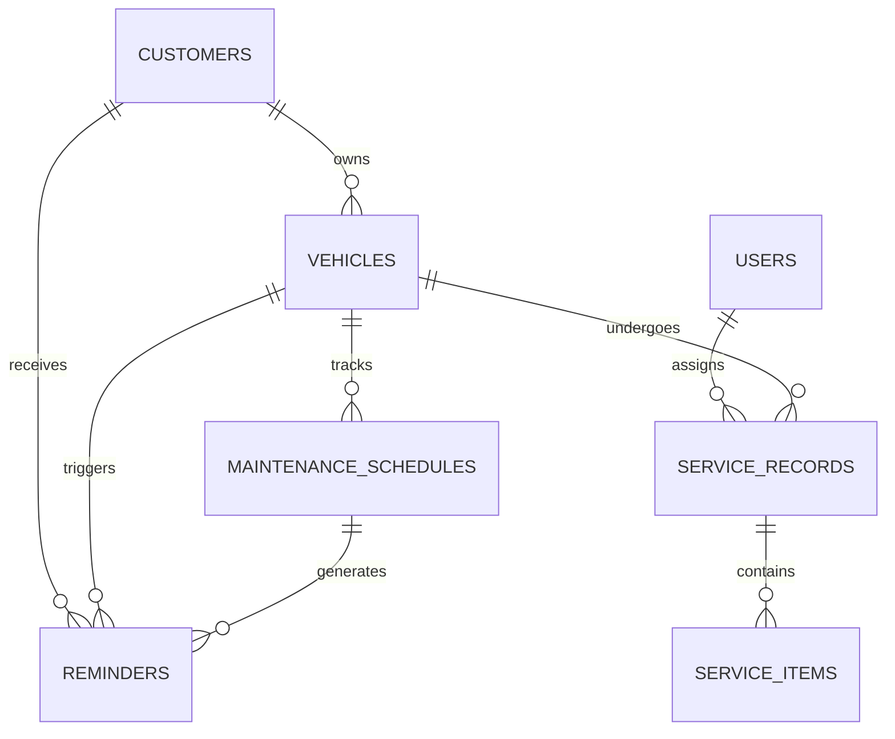

# FleetSync™ — Enterprise Vehicle Service & Maintenance Tracker

[](https://python.org)
[](https://flask.palletsprojects.com)
[-4479A1.svg?style=flat&logo=mysql&logoColor=white)](https://www.apachefriends.org/)
[](https://getbootstrap.com)
[](#)

> **FleetSync** is a commercial-grade, multi-tenant automotive service center and fleet lifecycle management system. Built with **Python Flask**, **MySQL (via XAMPP)**, and **Bootstrap 5**, it provides service advisors, technicians, and fleet operators with intelligent work orders, automated preventive maintenance countdowns, and real-time customer reminder dispatch.

---

## 🚀 Key Modules & Capabilities

### 1. Operations Command Center (Dashboard)
- **Real-Time KPIs**: Live tracking of fleet assets, active service bays, overdue schedules, and billed maintenance revenue.
- **Dynamic Telematics Analytics**:
  - Fleet Operational Health distribution (Doughnut chart with interactive tooltips).
  - Service volume by category (Engine, Brakes, Transmission, Inspection).
- **Urgent Maintenance Alert Banner**: Surfaces vehicles needing immediate service with one-click work order dispatch.

### 2. 360° Fleet & Customer Asset Management
- **Full Asset Specs**: VIN, License Plate, Make, Model, Year, Fuel Type, Powertrain, Color, and High-Resolution vehicle photography.
- **Mileage & Odometer History**: Automatically logs vehicle usage and triggers maintenance interval thresholds.
- **Customer Association**: Link vehicles to corporate fleet accounts or individual clients.

### 3. Preventive Maintenance Schedules (OEM Interval Automation)
- **Dual-Trigger Logic**: Recalculates service due status dynamically based on either elapsed calendar days or accumulated odometer mileage.
- **Priority Escalation**: Assign `Critical`, `High`, `Medium`, or `Low` severity levels to upcoming maintenance checkpoints.
- **Real-Time Status Badges**: Visual indicators (`Upcoming`, `Due Soon`, `Overdue`).

### 4. Work Orders & Itemized Billing Engine
- **Unique Work Order Generation**: System generates standardized identifiers (e.g., `WO-2026-0103`).
- **Interactive Line-Items Calculator**: Dynamic JavaScript calculator for parts, materials, and labor hours with automatic 8% tax calculation and real-time total updates.
- **Printable Invoices & Inspection Certificates**: Clean, printable layout (`@media print` optimized) complete with service center branding, itemized invoices, and customer signature blocks.

### 5. Automated Reminders & Customer Outreach Hub
- **Automated Scan Engine**: Analyzes all vehicle schedules with a single click and queues reminders for vehicles due within 14 days or 1,000 km.
- **Multi-Channel Dispatch**: Simulates and formats customer communication across **Email**, **SMS**, and **WhatsApp**.
- **Audit Logs**: Tracks dispatch timestamps and delivery status (`Scheduled`, `Sent`).

### 6. Role-Based Authentication & Security
- **Role Hierarchy**: `Admin` (full system control) and `Technician` (service execution).
- **Password Security**: Passwords hashed using industry-standard `scrypt` hashing via `Werkzeug`.
- **Protected Sessions**: Secure HTTP sessions with `@login_required` and `@admin_required` decorators.

---

## 🛠️ Technology Stack Matrix

| Layer | Technologies Used | Purpose |
| :--- | :--- | :--- |
| **Backend Core** | Python 3.14, Flask 3.1 | REST routing, template rendering, session management |
| **Database** | MySQL 8.x (via XAMPP) | Relational storage with foreign key constraints & cascading deletes |
| **Database Driver** | `mysql-connector-python` | Connection pooling and parameterized query execution |
| **Frontend UI** | HTML5, Vanilla CSS3, Bootstrap 5.3.3 | Enterprise SaaS responsive design system |
| **Typography** | Google Fonts (*Plus Jakarta Sans*) | Clean, high-legibility enterprise typography |
| **Animations** | AOS (Animate On Scroll) | Professional entrance animations and transitions |
| **Data Visualization** | Chart.js 4.4 | Real-time charts for revenue and fleet health |
| **Interactive Modals** | SweetAlert2 | Polished confirmation dialogues for deletion and dispatch |
| **Iconography** | FontAwesome 6.5.1 | Comprehensive automotive and operations icon set |

---

## 💾 Database Schema (`fleetsync_db`)

The database architecture consists of 7 normalized relational tables:



1. **`users`**: Staff profiles, roles (`Admin`, `Technician`, `Service Advisor`), and hashed credentials.
2. **`customers`**: Corporate accounts and individual vehicle owners.
3. **`vehicles`**: Vehicle specs, VIN, plate number, fuel type, odometer, and image.
4. **`maintenance_schedules`**: Interval configurations (km, months, priority, status).
5. **`service_records`**: Work order headers, labor/parts costs, status, and invoices.
6. **`service_items`**: Detailed parts and labor line items.
7. **`reminders`**: Automated notifications queue and delivery history.

---

## 🏁 Quick Start & Setup Guide

### Prerequisites
1. **Python 3.10+** installed on your system.
2. **XAMPP** installed (with Apache and MySQL modules).

### Step 1: Start MySQL in XAMPP
1. Open the **XAMPP Control Panel**.
2. Click **Start** next to the **MySQL** module (ensure port `3306` is active).

### Step 2: Initialize Database with 1 Command
Run the automated database setup and seeder script:
```powershell
python setup_db.py
```
*This will automatically connect to your XAMPP MySQL server, create the `fleetsync_db` database, establish all tables, and seed realistic demo customers, vehicles, schedules, and work orders.*

### Step 3: Launch the Application
```powershell
python app.py
```
Open your browser and navigate to:
👉 **`http://127.0.0.1:5000`**

---

## 🔑 Pre-Seeded Demo Credentials

| Role | Email | Password | Access Privileges |
| :--- | :--- | :--- | :--- |
| **System Administrator** | `admin@fleetsync.io` | `Admin@123` | Full access, user management, financial reports |
| **Service Technician** | `tech@fleetsync.io` | `Tech@123` | Work orders execution, parts logging, vehicle status |

*(Quick-Fill buttons are also provided directly on the Login page for one-click access)*

---

## 📁 Project Directory Structure

```
d:\internship 2\
├── app.py                 # Core Flask application with routes and controllers
├── config.py              # Application and MySQL XAMPP configuration
├── db.py                  # Database connection manager and query execution engine
├── setup_db.py            # Automated database creation and seeder script
├── schema.sql             # Full MySQL schema DDL script with seed data
├── requirements.txt       # Python package dependencies
├── README.md              # Project documentation
├── static/
│   ├── css/
│   │   └── style.css      # Custom enterprise SaaS theme & print styles
│   └── js/
│       ├── main.js        # SweetAlert confirms, line items calculator, AJAX
│       └── charts.js      # Chart.js visualization configurations
└── templates/
    ├── base.html          # Master layout with responsive sidebar and topbar
    ├── 404.html           # Professional error page
    ├── db_error.html      # Helpful XAMPP diagnostic screen
    ├── auth/
    │   ├── login.html     # Split-screen login with demo credentials quick-fill
    │   └── register.html  # Staff registration page
    ├── dashboard.html     # Operations command center with KPIs and charts
    ├── vehicles/
    │   ├── index.html     # Vehicle list with status filters and thumbnail grid
    │   ├── view.html      # 360-degree vehicle profile with service timeline
    │   └── form.html      # Register / Edit vehicle with image presets
    ├── customers/
    │   ├── index.html     # Customer directory with fleet metrics
    │   ├── view.html      # Customer profile and owned assets
    │   └── form.html      # Add / Edit customer
    ├── schedules/
    │   ├── index.html     # Preventive maintenance schedules tracker
    │   └── form.html      # Add / Edit maintenance interval rule
    ├── services/
    │   ├── index.html     # Work orders list with status filters
    │   ├── view.html      # Work order detail with parts breakdown
    │   ├── form.html      # Create / Edit order with live cost calculator
    │   └── invoice.html   # Professional printable invoice & inspection cert
    ├── reminders/
    │   └── index.html     # Automated reminders hub with 1-click scan
    └── reports/
        └── index.html     # Revenue analytics and CSV export
```

---

## 📄 License & Academic Integrity
Developed as an **Enterprise Vehicle Service & Maintenance Management** system. Designed for commercial operations, internship evaluation, and production automotive workshops.
# fleet_sync

